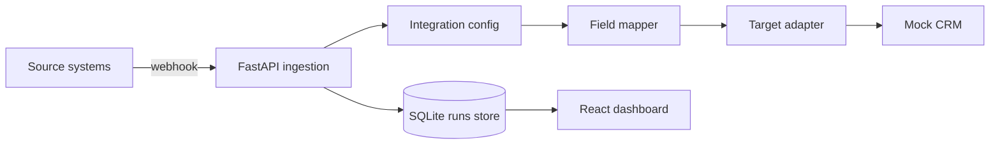

# AgentBridge

AgentBridge is a production-style integration runtime for AI-agent workflows.
It receives webhooks, normalizes payloads through configurable mappings, and
delivers records to target systems through adapters.

The project was built to demonstrate the core skills needed for integrations
engineering: Python, TypeScript, APIs, idempotency, retries-ready architecture,
structured payload handling, and a dashboard for inspecting workflow runs.

## Features

- FastAPI backend with SQLite persistence
- Webhook ingestion with idempotency keys
- Adapter interface for target systems
- Deterministic field mapping assistant
- React and TypeScript operations dashboard
- Docker Compose setup
- Backend tests and GitHub Actions CI

## Architecture



## Quickstart

### Backend

```bash
cd backend
python3 -m venv .venv
source .venv/bin/activate
pip install ".[dev]"
uvicorn app.main:app --reload
```

The API runs on `http://localhost:8000`.

### Frontend

```bash
cd frontend
npm install
npm run dev
```

The dashboard runs on `http://localhost:5173`.

### Docker Compose

```bash
docker compose up --build
```

## Example Webhook

```bash
curl -X POST http://localhost:8000/webhooks/github \
  -H "Content-Type: application/json" \
  -H "X-Idempotency-Key: issue-4812-opened" \
  -d '{
    "issue": {
      "id": 4812,
      "title": "Sync HubSpot company lifecycle stage",
      "html_url": "https://github.com/acme/revops/issues/4812",
      "labels": [{"name": "high"}]
    },
    "repository": {
      "full_name": "acme/revops"
    }
  }'
```

## API Surface

- `GET /health`
- `GET /integrations`
- `POST /integrations`
- `POST /webhooks/{source}`
- `GET /runs`
- `GET /runs/{run_id}`
- `POST /mapping/suggest`

## Why This Exists

Enterprise agent platforms live or die by the quality of their integrations.
AgentBridge focuses on the boring-but-critical parts: webhook ingestion,
idempotency, payload mapping, adapter boundaries, observability, and an operator
view for debugging what happened.

## Roadmap

- Add queued background workers
- Add adapter-level retry policies and dead-letter runs
- Add OAuth credential storage
- Add real Slack, GitHub, and HubSpot adapters
- Add optional LLM-assisted mapping with `LLM_PROVIDER_API_KEY`
