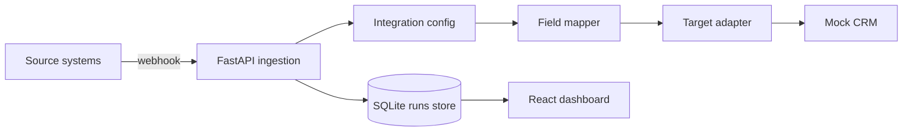

# AgentBridge

AgentBridge is a small integration platform for AI-assisted workflows. It
receives webhooks from source systems, maps incoming JSON into a target schema,
records every run, and delivers the normalized payload through target adapters.

The project focuses on the parts of integrations work that usually matter in
practice: idempotency, changing webhook payloads, adapter boundaries, local
observability, and a simple operator view for debugging what happened.

## Features

- FastAPI backend with SQLite persistence
- Webhook ingestion with idempotency keys
- Adapter interface for target systems
- Deterministic field-mapping suggestions
- Mock CRM target adapter for local development
- React and TypeScript operations dashboard
- Docker Compose setup
- Backend tests and GitHub Actions CI

## Architecture



## Quickstart

### Backend

```bash
cd backend
python3 -m venv .venv
source .venv/bin/activate
pip install ".[dev]"
uvicorn app.main:app --reload
```

The API runs on `http://localhost:8000`.

### Frontend

```bash
cd frontend
npm install
npm run dev
```

The dashboard runs on `http://localhost:5173`.

No external API keys are required for the default demo flow.

### Docker Compose

```bash
docker compose up --build
```

## Example Webhook

```bash
curl -X POST http://localhost:8000/webhooks/github \
  -H "Content-Type: application/json" \
  -H "X-Idempotency-Key: issue-4812-opened" \
  -d '{
    "issue": {
      "id": 4812,
      "title": "Sync HubSpot company lifecycle stage",
      "html_url": "https://github.com/acme/revops/issues/4812",
      "labels": [{"name": "high"}]
    },
    "repository": {
      "full_name": "acme/revops"
    }
  }'
```

## API Surface

- `GET /health`
- `GET /integrations`
- `POST /integrations`
- `POST /webhooks/{source}`
- `GET /runs`
- `GET /runs/{run_id}`
- `POST /mapping/suggest`

## Code To Look At

- `backend/app/main.py` wires the FastAPI routes.
- `backend/app/store.py` handles SQLite persistence and idempotency.
- `backend/app/mapper.py` contains the field mapping logic.
- `backend/app/adapters/` shows the adapter boundary for target systems.
- `frontend/src/main.tsx` contains the dashboard and webhook simulator.

## Why This Exists

Integrations are rarely just "send JSON from A to B". Real systems need a way
to replay events safely, inspect failed runs, change mappings without rewriting
the pipeline, and add new target systems without touching ingestion code.

AgentBridge is a compact version of that idea: small enough to run locally, but
structured like a service that could grow into real Slack, GitHub, CRM, or
internal-tool integrations.

## Roadmap

- Add queued background workers
- Add adapter-level retry policies and dead-letter runs
- Add OAuth credential storage
- Add real Slack, GitHub, and HubSpot adapters
- Add optional LLM-assisted mapping with `LLM_PROVIDER_API_KEY`
